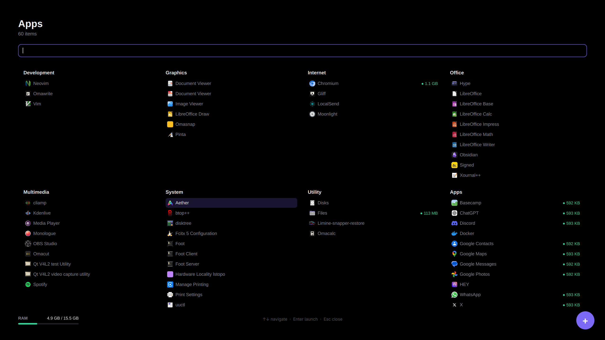

# Min Launcher

Fullscreen app launcher overlay for Omarchy 4.x (Quattro / Quickshell).

**Layout** inspired by Design Engineer Tools. **Items** are installed native apps (Omarchy `AppLibrary` when the shell provides it, otherwise Quickshell `DesktopEntries`) plus a curated **Web Apps** section that opens in the browser.

Native apps are grouped by FreeDesktop category (Development, Graphics, Internet, Office, Multimedia, System, Utility, Games, Apps). Browser tools appear under **Web Apps**.

## Install

```bash
omarchy plugin add https://github.com/maiosx/min-launcher.git --enable --yes
```

Update:

```bash
omarchy plugin update
omarchy restart shell   # keepLoaded plugins only pick up QML changes after a restart
```

## Summon

```bash
omarchy-shell shell toggle min-launcher '{}'
```

The payload argument (`'{}'`) is required by current Omarchy IPC.

Suggested keybind in `~/.config/hypr/bindings.lua`:

```lua
o.bind("SUPER + B", "Min Launcher", "omarchy-shell shell toggle min-launcher '{}'")
```

## Usage

- Type to filter across all sections
- Click an app or **Enter** to launch (native via `AppLibrary.launch` or `uwsm-app`/`gtk-launch`, web via browser)
- **↑↓** move selection · **Esc** clear filter / close
- Running apps show their **RAM** use (green, live, PSS summed across all their processes) next to the title; hover any native app to also see its **disk size**
- The **RAM** meter (bottom left) shows live system-wide memory use; the bar turns amber above 75% and red above 90%
- Use the **+** button (bottom right) to add a web app (title + URL)
- Use the **−** next to a web app to remove it

Custom web apps are saved to `~/.config/omarchy/min-launcher-web-apps.json`.

## Remove

Disable and uninstall the plugin:

```bash
omarchy plugin disable min-launcher
omarchy plugin remove min-launcher --yes
```

If you added a keybind, delete it from `~/.config/hypr/bindings.lua`.

To wipe any leftover config under your home directory:

```bash
rm -rf ~/.config/omarchy/plugins/min-launcher
rm -f ~/.config/omarchy/min-launcher-web-apps.json
```

(Paths may vary slightly by Omarchy version; `omarchy plugin list` shows installed plugins.)

## Structure

```
manifest.json
Launcher.qml    Fullscreen multi-column overlay
Tools.js        AppLibrary list, Web Apps, filter, category grouping
appinfo.sh      Lookups: running-app RAM (all apps) and installed size (on hover)
Preview.png     Screenshot
README.md
LICENSE
```

## License

MIT
